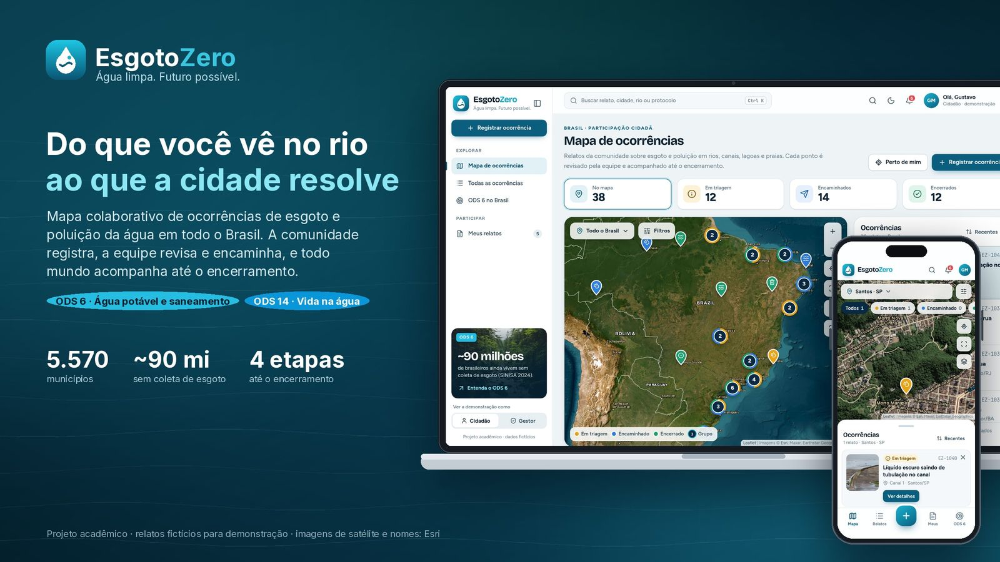
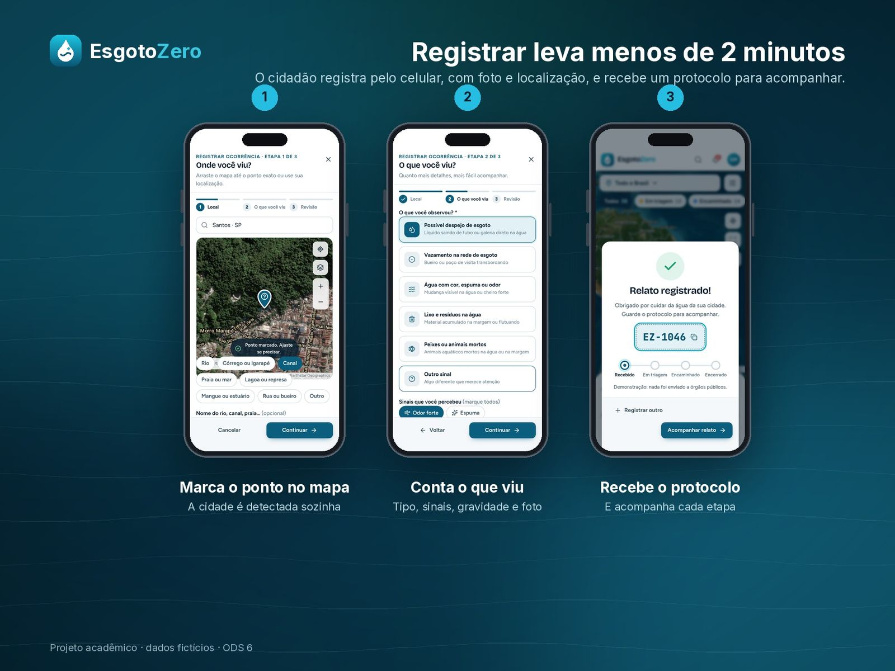
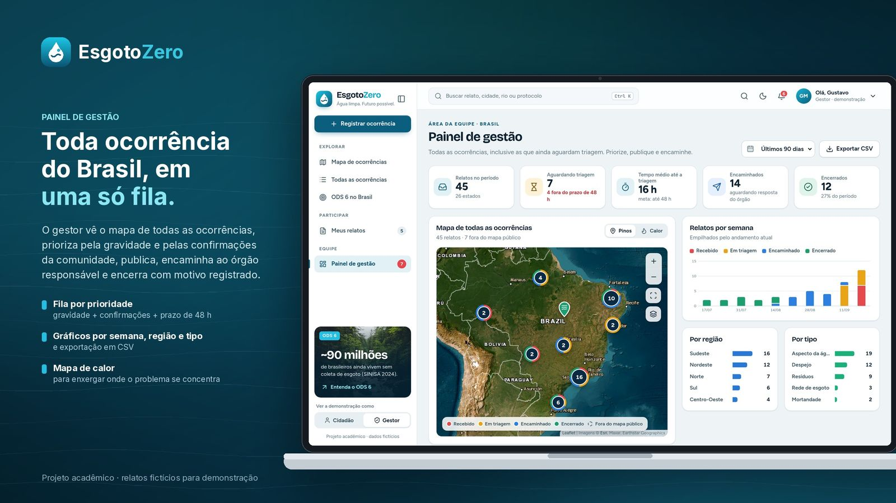

# EsgotoZero

**Do que você vê no rio ao que a cidade resolve.** O EsgotoZero é um mapa colaborativo de ocorrências de esgoto e poluição da água em todo o Brasil. A comunidade registra o que viu, a equipe revisa e encaminha ao órgão responsável, e todo mundo acompanha cada relato até o encerramento.

Projeto acadêmico do curso de Análise e Desenvolvimento de Sistemas, ligado ao **ODS 6** (água potável e saneamento) e ao **ODS 14** (vida na água).

🔗 **Demonstração:** https://comforting-kheer-a0c28d.netlify.app



> **Importante:** esta é uma demonstração. Os relatos do mapa são fictícios e as fotos são ilustrativas. O que alguém registra fica salvo só no navegador dessa pessoa, e nada é enviado a órgãos públicos. O plano para a versão com contas e banco de dados está em [docs/PROXIMOS-PASSOS.md](docs/PROXIMOS-PASSOS.md).

## O que o sistema faz

**Para o cidadão**
- Mapa do Brasil com os relatos publicados, agrupados por região, com filtros por lugar (região, estado, cidade ou "perto de mim"), andamento, tipo, gravidade e período.
- Registro em 3 etapas, em menos de 2 minutos: marca o ponto no mapa (a cidade é detectada entre os 5.570 municípios), diz o que viu e envia, com foto opcional.
- Aviso de relato parecido por perto, com a opção "É o mesmo" para confirmar em vez de duplicar.
- "Meus relatos" com o andamento de cada um e notificações a cada mudança.
- Rascunho salvo automaticamente, tema claro e escuro, busca rápida (Ctrl + K).
- Responsivo de 320 px a telas grandes, em pé e deitado. Funciona como app no celular (dá para instalar), abre sem internet e respeita o botão "voltar" do Android.

**Para a equipe (perfil de gestor)**
- Fila de triagem ordenada por prioridade (gravidade + confirmações + tempo de espera), com prazo de 48 h.
- Revisão, publicação, revisão da foto, encaminhamento ao órgão e encerramento com motivo, tudo registrado no histórico.
- Indicadores, gráficos por semana, região e tipo, mapa de calor e exportação em CSV.

**Página "ODS 6 no Brasil"** com dados reais de saneamento (SINISA 2024, Instituto Trata Brasil), as metas do Marco Legal do Saneamento e os canais oficiais de denúncia.

<p>
  
  
</p>

## Como rodar no seu computador

O site é estático: HTML, CSS e JavaScript puro, sem build e sem instalar dependências. Ele só precisa ser aberto por um **servidor local**. Abrir o `index.html` com dois cliques até funciona, mas o modo offline e algumas partes do mapa precisam de `http://`.

Escolha uma das opções, dentro da pasta do projeto:

| Opção | Comando ou passo | Endereço |
|---|---|---|
| VS Code | Instale a extensão **Live Server** e clique em "Go Live" | o que aparecer na barra de status |
| Node.js | `npm run dev` | http://localhost:5173 |
| Python | `python -m http.server 5173` | http://localhost:5173 |

Para experimentar os dois lados, use o seletor **Cidadão / Gestor** no menu lateral. Para voltar aos exemplos originais: **Seu perfil → Reiniciar dados**.

### Verificar antes de enviar

```bash
npm run check
```

O comando confere a sintaxe de todos os arquivos JavaScript, se todo arquivo citado existe, se todo ícone usado está em `js/icons.js` e se o modo offline está completo. O GitHub roda a mesma verificação a cada envio (aba **Actions**).

## Estrutura

```
index.html              página única (as telas são trocadas pelo JavaScript)
manifest.webmanifest    dados para instalar como app
sw.js                   modo offline (service worker)
css/styles.css          todo o visual: cores, temas claro/escuro, celular
js/
  data.js               categorias, estados, dados do ODS 6 e relatos fictícios
  core.js               utilitários, armazenamento, filtros, diálogos
  map.js                mapas (Leaflet), marcadores e camadas
  charts.js             gráficos em SVG
  ui.js                 componentes: ficha do relato, perfil, filtros, busca rápida
  pages.js              telas: mapa, ocorrências, meus relatos, gestão, ODS 6
  register.js           registro de ocorrência em 3 etapas
  app.js                rotas, eventos e inicialização
  icons.js              ícones (Lucide)
  municipios.js         5.570 municípios do IBGE (carregado sob demanda)
vendor/                 Leaflet e plugins (com as licenças)
assets/                 fontes, ícones do app e fotos ilustrativas
docs/                   documentação, plano do backend e imagens do README
apk/                    app Android (Capacitor): abra apk/android no Android Studio
scripts/check.mjs       verificação do projeto
```

Detalhes de cada módulo e do formato dos dados: [docs/ARQUITETURA.md](docs/ARQUITETURA.md).

## Publicar

- **Netlify:** o `netlify.toml` já está pronto (publica a pasta como está e roda a verificação antes). Conectando o repositório do GitHub ao Netlify, cada envio para a `main` vira uma nova versão no ar.
- **Netlify Drop:** arraste a pasta do projeto em https://app.netlify.com/drop.
- **GitHub Pages:** em *Settings → Pages*, escolha a branch `main` e a pasta `/ (root)`.

## Gerar o APK (Android)

O projeto Android já está pronto em `apk/android`: abra essa pasta no Android Studio e use **Build → Build APK(s)**. Passo a passo, APK assinado e a alternativa pelo PWABuilder em [docs/APK.md](docs/APK.md).

## Como contribuir

Leia o [CONTRIBUTING.md](CONTRIBUTING.md): ele explica como clonar, criar uma branch, enviar alterações e abrir um pull request. As tarefas que faltam estão em [docs/PROXIMOS-PASSOS.md](docs/PROXIMOS-PASSOS.md).

## Equipe

- Gustavo Mota de Paula
- Pedro Henrique Sales Siquele RGM 43001696
- Higor Vinícius Garcia - RGM: 42948525
- Rodrigo Franco Navero Martins RGM: 43049184
- Victor Ribeiro Gomes RGM: 42947979
- Lucas Holanda dos santos lima RGM:48659282

## Créditos e licenças

- Mapa: [Leaflet](https://leafletjs.com) (BSD-2-Clause), Leaflet.markercluster (MIT) e Leaflet.heat (BSD-2-Clause). Licenças em `vendor/`.
- Imagens de satélite, ruas e nomes: Esri (Maxar, Earthstar Geographics, HERE, Garmin) e © colaboradores do OpenStreetMap. As atribuições aparecem no próprio mapa.
- Busca de endereços: [Photon](https://photon.komoot.io) (Komoot), com dados do OpenStreetMap.
- Ícones: [Lucide](https://lucide.dev) (ISC).
- Fontes: Bricolage Grotesque, Figtree e JetBrains Mono (SIL Open Font License). Licenças em `assets/fonts/`.
- Municípios: IBGE, via [kelvins/municipios-brasileiros](https://github.com/kelvins/municipios-brasileiros) (MIT).
- Fotos ilustrativas: rio por Ingo Stiller ([Unsplash License](https://unsplash.com/license)) e tubulação por Paul McIlroy/Geograph ([CC BY-SA 2.0](https://creativecommons.org/licenses/by-sa/2.0/)), recortadas.
- Dados de saneamento: SINISA 2024 (Ministério das Cidades), divulgados pelo [Instituto Trata Brasil](https://tratabrasil.org.br/ranking-do-saneamento-2026/).
